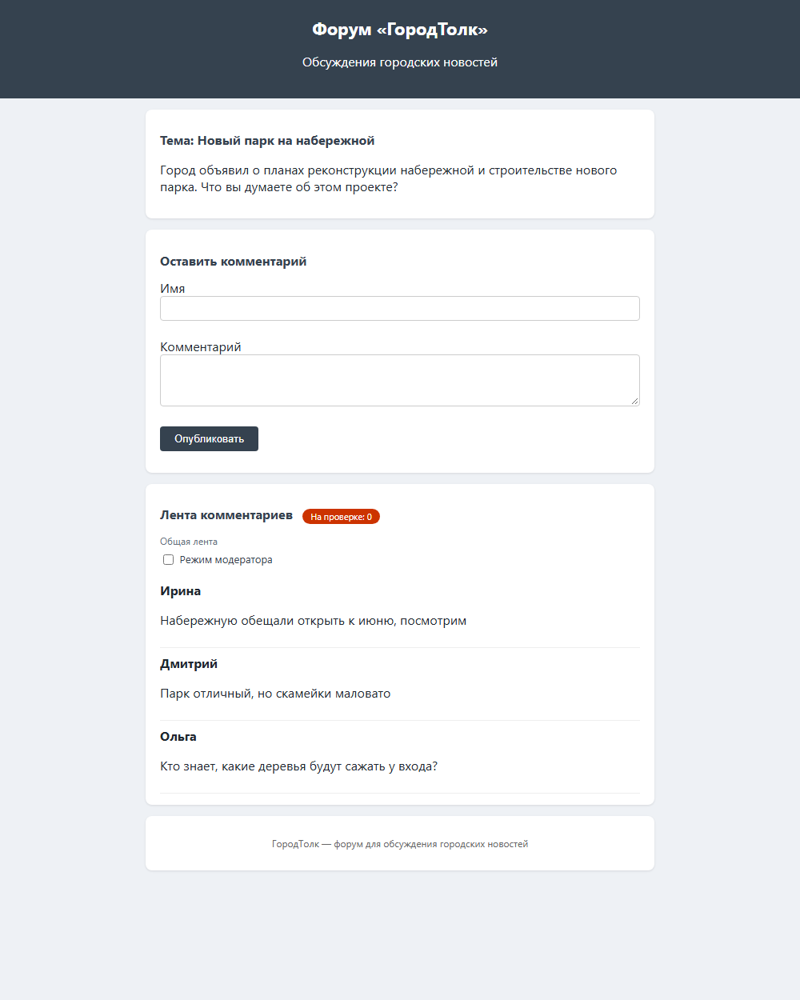
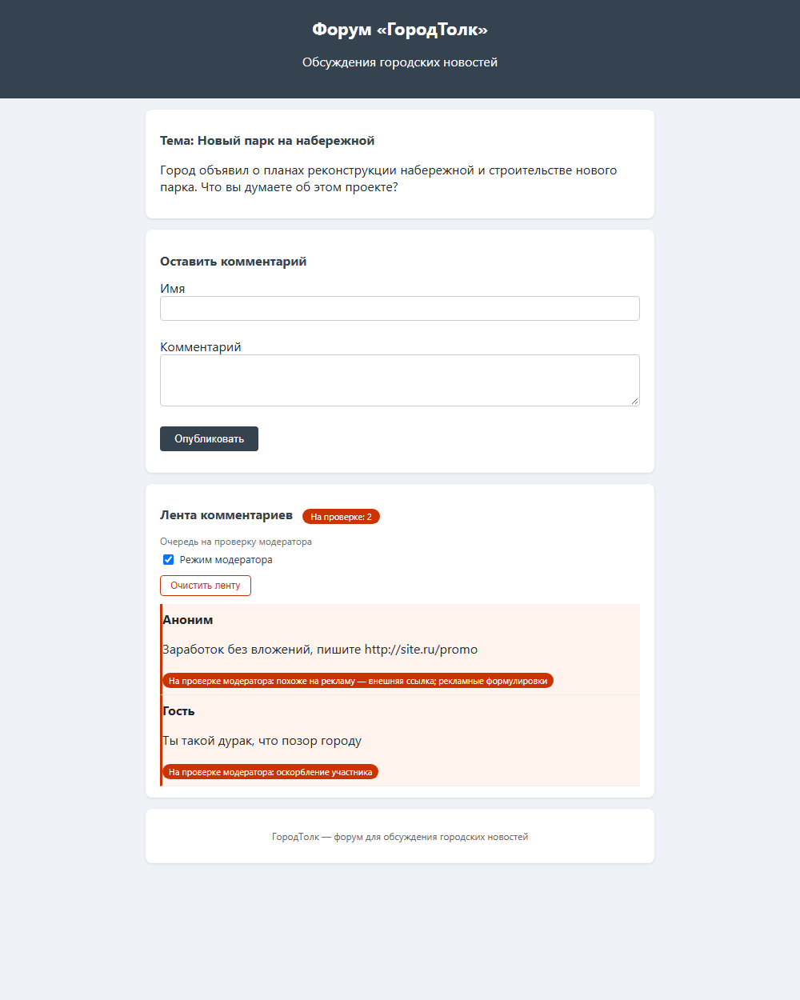
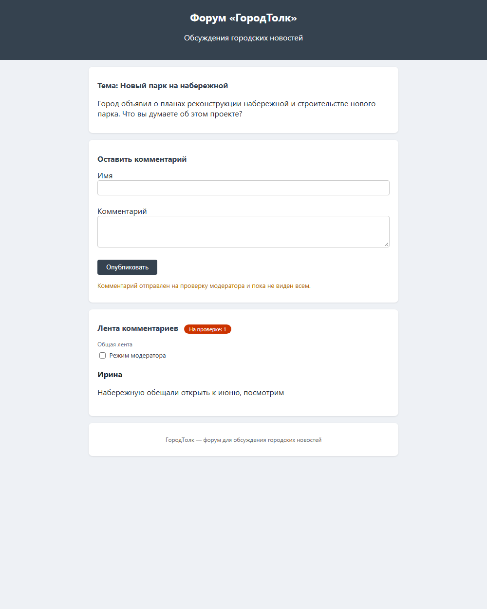
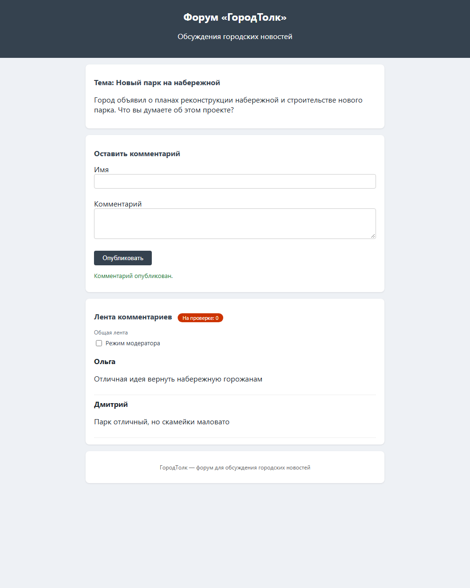

<div align="center">

# 🏙️ Форум «ГородТолк»

**Статический городской форум с умной модерацией комментариев**

`без сервера` · `без сборки` · `без зависимостей` · `работает офлайн`

[](https://developer.mozilla.org/ru/docs/Web/HTML)
[](https://developer.mozilla.org/ru/docs/Web/CSS)
[](https://developer.mozilla.org/ru/docs/Web/JavaScript)
[](https://developer.mozilla.org/ru/docs/Web/API/Window/localStorage)
[](#-метрики-качества)

</div>

---

## 📸 Скриншоты

<table>
  <tr>
    <td align="center"><b>Общая лента</b></td>
    <td align="center"><b>Очередь модератора</b></td>
  </tr>
  <tr>
    <td></td>
    <td></td>
  </tr>
  <tr>
    <td align="center"><b>Комментарий на проверке</b></td>
    <td align="center"><b>Успешная публикация</b></td>
  </tr>
  <tr>
    <td></td>
    <td></td>
  </tr>
</table>

---

## 🎯 О проекте

«ГородТолк» — форум для обсуждения городских новостей, который работает
как **обычная статическая страница**: откройте `index.html` двойным
щелчком — и всё работает. Ни сервера, ни сборки, ни npm, ни ключей API.

Главная особенность — **встроенная модерация комментариев**: каждый
комментарий проходит проверку по 12 правилам ещё до публикации.
Подозрительный текст не исчезает и не блокируется молча — он уходит в
**очередь модератора** с понятной причиной, а обычные посетители его не
видят.

## ✨ Возможности

- 🛡️ **12 правил модерации** (R01–R12): реклама и ссылки, грубая
  лексика, контактные данные, капс, флуд, повторы, длина, обфускация
- ⚖️ **Система баллов с порогом 100** — один блокирующий признак или
  несколько средних отправляют комментарий на проверку
- 👤 **Режим модератора** — переключатель над лентой, счётчик
  «На проверке: N», очередь с метками и причинами, кнопка очистки
- 🚫 **Отклонённые скрыты от всех** — в общей ленте их не видит никто,
  кроме модератора
- 🧠 **Устойчивость к обходам** — омоглифы (`дурaк`), вставки
  (`х * й`), повторы символов, обфусцированные ссылки
- 🔗 **Белый список ссылок** — википедия и госсайты не считаются рекламой
- 📦 **Миграция старых записей** — комментарии прошлых версий не теряются
  и не попадают в очередь
- ⚠️ **Гарантия публикации** — сбой проверки никогда не теряет текст
  комментария (режим `fallback`)
- 📱 **Без сети** — ноль запросов, работает в самолёте и по `file://`

## 🛡️ Как работает модерация

```text
         Комментарий
              │
              ▼
      ┌───────────────┐
      │ Нормализация  │  регистр, омоглифы, повторы, метрики
      └───────┬───────┘
              ▼
      ┌───────────────┐
      │ 12 правил     │  каждое срабатывание даёт баллы
      └───────┬───────┘
              ▼
        Сумма баллов
       /           \
   < 100          ≥ 100
     │              │
     ▼              ▼
 Публикация    Очередь модератора
  в ленте      (скрыта от всех)
```

| Правило | Признак | Вес |
|:--|:--|:-:|
| R01 | Внешняя ссылка / рекламная страница | 100 |
| R02 | Мат и оскорбления (словари) | 100 |
| R03 | Телефон, @ник, «пишите в личку» | 100 |
| R04 | Рекламный лексикон (явный / мягкий) | 100 / 40 |
| R05 | Флуд и повторяющийся текст | 100 |
| R06 | Агрессивный капс (длинный капс-стоп) | 40 / 100 |
| R07 | Повторяющиеся символы `!!!!` | 40 |
| R08 | Бессмысленно-короткая реакция | 40 |
| R09 | Слишком длинный комментарий | 40 |
| R10 | Смешение алфавитов (`раcсказ`) | 40 |
| R11 | `!!!` / `???` подряд | 15 |
| R12 | Нет буквенного текста | 40 |

Словари и порог вынесены в конфигурацию в начале `script.js` —
пополняются **без изменения логики** (ТЗ, FR-10).

## 📊 Метрики качества

Приёмочный прогон по ТЗ (разд. 15, набор из 45 примеров):

| Метрика | Норма ТЗ | Факт |
|:--|:-:|:-:|
| Найден спам (recall) | ≥ 90 % | **100 %** (15/15) |
| Ложные срабатывания | ≤ 10 % | **0 %** (0/30) |
| Время проверки | < 20 мс | **< 1 мс** |
| Ошибки / исключения | 0 | **0** |
| Сетевые запросы при модерации | 0 | **0** |

Автотесты: **224 проверки, 0 падений** — правила, интерфейс,
последовательные отправки, безопасность словарей, метрики ТЗ.

## 🚀 Как запустить

**Способ 1 — сразу в браузере:**

```text
Двойной щелчок по index.html
```

**Способ 2 — локальный сервер:**

```bash
python3 -m http.server 8000
# затем откройте http://localhost:8000
```

Оба способа проверены: страница полностью работает и по `file://`,
и через `http.server`.

## 🗂 Структура проекта

```text
├── index.html                    # разметка: форма, лента, режим модератора
├── style.css                     # стили, включая метки и уведомления
├── script.js                     # конфиг, правила R01–R12, moderateComment
├── screenshots/                  # скриншоты для этой страницы
├── ЗАПУСК.md                     # инструкция по запуску
├── ОПИСАНИЕ.md                   # краткое описание работы
├── ТЗ_МОДЕРАЦИЯ_КОММЕНТАРИЕВ.md  # договорное техническое задание
├── ОТКЛОНЕНИЯ_ОТ_ТЗ.md           # 5 согласованных отклонений от ТЗ
├── .env.example                  # ориентир для этапа с внешним API
└── PROMPT_EXAMPLE.md             # промпт для ИИ-этапа (серверный прокси)
```

## 📚 Документация

| Документ | О чём |
|:--|:--|
| [ЗАПУСК.md](ЗАПУСК.md) | Как запустить, что реализовано, где настраивать |
| [ОПИСАНИЕ.md](ОПИСАНИЕ.md) | Коротко о том, как устроен проект |
| [ТЗ на модерацию](ТЗ_МОДЕРАЦИЯ_КОММЕНТАРИЕВ.md) | Полное техническое задание (v1.1) |
| [Отклонения от ТЗ](ОТКЛОНЕНИЯ_ОТ_ТЗ.md) | Согласованные правки: 5 пунктов с обоснованиями |

## 🗺 Возможное развитие

- **Шаг 2 — внешний ИИ**: режим `MODERATION_MODE = "api"` через
  серверный прокси (ключ в браузер не встраивается — ТЗ SEC-01/SEC-02);
  материалы уже в репозитории: `.env.example`, `PROMPT_EXAMPLE.md`
- Кнопки одобрения/отклонения в очереди модератора
- Экспорт и статистика очереди

---

<div align="center">

Сделано на чистом HTML · CSS · JavaScript — без фреймворков и сборщиков

</div>
